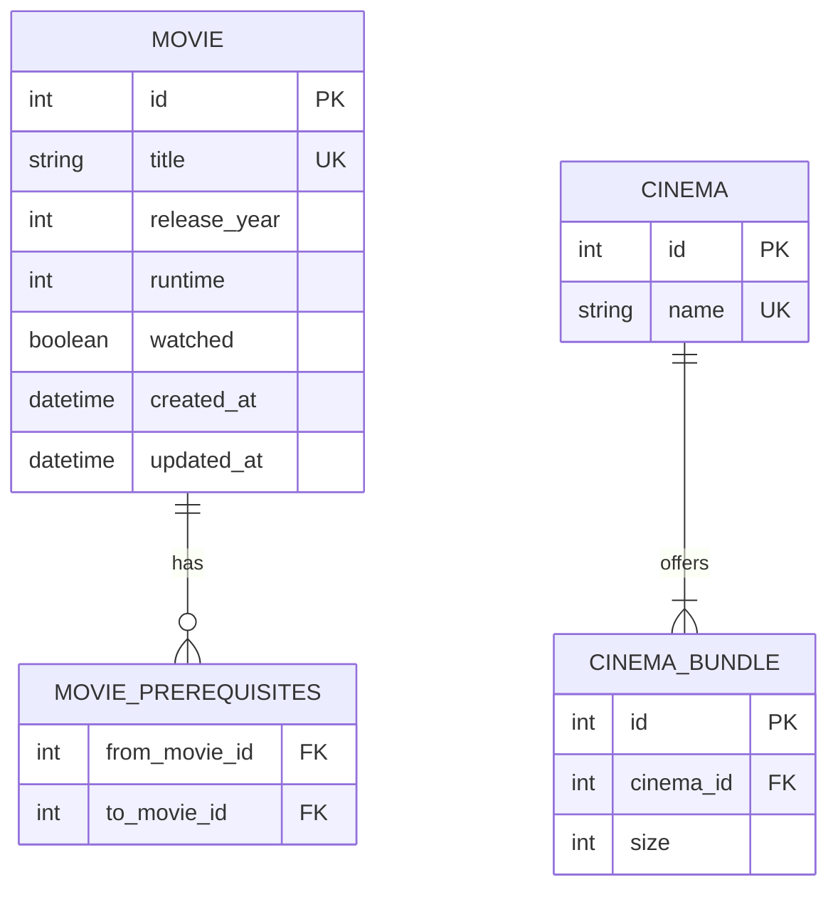

# Doomsday Ready — Full-Stack Application

A full-stack movie management and cinema booking application built with Django REST Framework, PostgreSQL, React, and Docker.

## Features

### 1. Movie Management
- Create, retrieve, update, and delete movies.
- Each movie has a unique title.
- Store release year and runtime.
- Track watched status.
- Define prerequisite movies through a directed relationship.
- Reject circular dependencies with HTTP 409 and `CIRCULAR_DEPENDENCY`.

### 2. Rewatch Planning
- Generate prerequisite-first viewing order.
- Include all transitive prerequisites exactly once.
- Exclude the selected target movie.
- Calculate watched and unwatched movie counts.
- Calculate total remaining runtime.

### 3. Cinema Booking
- Create cinemas with unique names.
- Configure 1–10 unique bundle sizes.
- Calculate the minimum number of bundles for a group.
- Support group sizes from 1 to 10,000.
- Return an impossible result when an exact combination does not exist.

## Technology Stack

### Backend
- Python
- Django
- Django REST Framework
- PostgreSQL

### Frontend
- React
- Vite
- JavaScript
- CSS


## Project Structure

```text
Doomsday-Ready/
├── backend/
│   ├── config/
│   ├── movies/
│   ├── cinemas/
│   ├── manage.py
│
frontend/
| └──src/
│    ├── components/
│    │   ├── CinemaBooking.jsx
│    │   ├── MovieForm.jsx
│    │   ├── MovieList.jsx
│    │   ├── Navbar.jsx
│    │   └── RewatchPlan.jsx
│    ├── services/
│    │   └── api.js
│    ├── App.css
│    ├── App.jsx
│    ├── index.css
│    └── main.jsx
├── .gitignore
├── .oxlintrc.json
├── index.html
├── package-lock.json
├── package.json
└── vite.config.js
```

## Database Design

The application uses three main entities:

- Movie
- Cinema
- CinemaBundle

### Relationship Diagram



A movie can have multiple prerequisite movies, and a prerequisite can be shared by multiple movies.

Each cinema has one or more available bundle sizes.

## API Endpoints

### Movies

| Method | Endpoint | Description |
|---|---|---|
| GET | `/api/movies/` | List movies |
| POST | `/api/movies/` | Create movie |
| GET | `/api/movies/{id}/` | Retrieve movie |
| PATCH | `/api/movies/{id}/` | Update movie |
| DELETE | `/api/movies/{id}/` | Delete movie |
| GET | `/api/movies/{id}/rewatch-order/` | Generate rewatch plan |

### Cinemas

| Method | Endpoint | Description |
|---|---|---|
| GET | `/api/cinemas/` | List cinemas |
| POST | `/api/cinemas/` | Create cinema |
| GET | `/api/cinemas/{id}/` | Retrieve cinema |
| PATCH | `/api/cinemas/{id}/` | Update cinema |
| DELETE | `/api/cinemas/{id}/` | Delete cinema |
| GET | `/api/cinemas/{id}/booking/?groupSize=10` | Calculate booking quote |

## Example Requests

### Create a Movie

```json
{
  "title": "Iron Man",
  "release_year": 2008,
  "runtime": 126,
  "watched": false,
  "prerequisites": []
}
```

### Create a Movie with Prerequisites

```json
{
  "title": "The Avengers",
  "release_year": 2012,
  "runtime": 143,
  "watched": false,
  "prerequisites": [1]
}
```

### Create a Cinema

```json
{
  "name": "Star Cineplex",
  "bundle_sizes": [1, 3, 4]
}
```

### Booking Quote

```text
GET /api/cinemas/1/booking/?groupSize=6
```

## Algorithms

### Rewatch Planning

A depth-first search (DFS) traversal is used to visit prerequisite movies.

- A visited set prevents duplicate movies.
- A visiting set detects cycles.
- Post-order traversal produces prerequisite-first order.
- The target movie is excluded from the resulting plan.

Time complexity: O(V + E), where V is the number of movies and E is the number of prerequisite relationships in the traversed graph.

### Cinema Booking

Dynamic programming is used to find the minimum number of bundles.

- Initialize a DP array for group sizes.
- Calculate the minimum bundle count for each amount.
- Store the selected previous bundle.
- Reconstruct the selected bundle quantities.
- Return impossible if the exact group size cannot be formed.

Time complexity: O(G × B), where G is the requested group size and B is the number of available bundle sizes.

No graph or coin-change algorithm library is used.

## Run Locally

### Backend

```bash
cd backend

uv sync

uv run python manage.py migrate

uv run python manage.py runserver
```

Backend URL:

http://127.0.0.1:8000/

### Frontend

```bash
cd frontend

npm install

npm run dev
```

Frontend URL:

http://localhost:5173/


## Testing

Test the following:

1. Create, retrieve, update, and delete movies.
2. Reject duplicate movie titles.
3. Reject runtime values outside 1–300.
4. Reject circular movie dependencies with HTTP 409.
5. Generate a rewatch plan with multiple prerequisites.
6. Ensure shared prerequisites appear only once.
7. Confirm the target movie is excluded.
8. Verify watched and remaining-runtime calculations.
9. Create cinemas with valid bundle sizes.
10. Reject duplicate bundle sizes.
11. Verify minimum bundle count using a case where greedy selection fails.
12. Verify impossible booking sizes.

## Author

Doomsday Ready — Full-Stack Application
